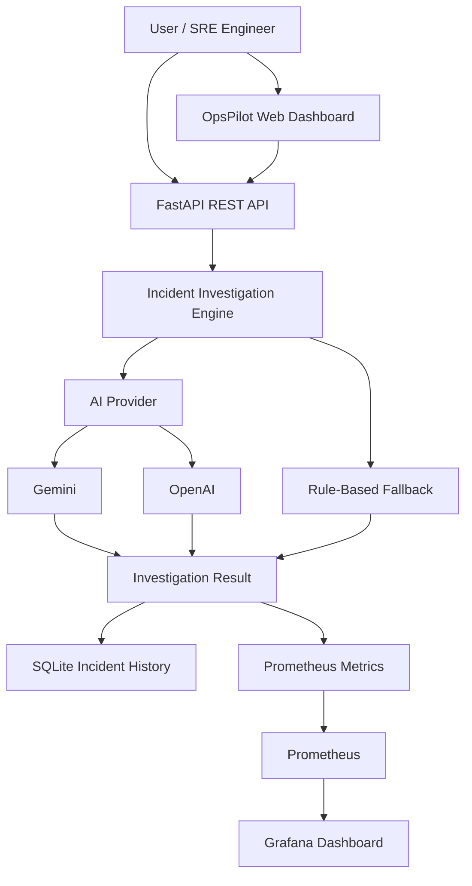

# 🚀 OpsPilot AI
### AI-Assisted DevOps Incident Investigation & Observability Platform

OpsPilot AI is an AI-assisted incident investigation platform designed to help DevOps and SRE engineers analyze simulated infrastructure incidents, correlate logs and metrics, identify probable root causes, and receive actionable remediation suggestions.

It combines an optional Gemini/OpenAI integration with an evidence-based rule engine fallback, persistent incident history, REST APIs, and real-time observability through Prometheus and Grafana.

> **Project status:** Working local MVP. Docker deployment, incident investigation, SQLite persistence, Prometheus monitoring, Grafana dashboards, and automated tests have been verified locally.

---

## ✨ Features

- **Incident Investigation:** Analyze database, CPU, and memory incident scenarios.
- **AI-Assisted Analysis:** Optional Gemini and OpenAI provider integrations.
- **Rule-Based Fallback:** Continue investigations when AI providers are unavailable or quota is exhausted.
- **Evidence Correlation:** Analyze incident descriptions, log evidence, and metric observations.
- **Root Cause Analysis:** Generate probable causes and confidence scores.
- **Remediation Guidance:** Provide actionable troubleshooting recommendations.
- **Incident History:** Store and retrieve investigation records using SQLite.
- **REST API:** FastAPI endpoints with interactive Swagger documentation.
- **Monitoring:** Prometheus metrics collection.
- **Visualization:** Grafana monitoring dashboard.
- **Containerization:** Docker Compose deployment.
- **Automated Testing:** Pytest-based API tests.

---

## 🏗️ Architecture



---

## 🛠️ Technology Stack

| Component | Technology |
|---|---|
| Backend | Python, FastAPI |
| Validation | Pydantic |
| AI integration | Google Gemini, OpenAI |
| Fallback engine | Python rule-based analysis |
| Database | SQLite |
| Monitoring | Prometheus |
| Visualization | Grafana |
| Deployment | Docker, Docker Compose |
| Testing | Pytest |
| API documentation | Swagger / OpenAPI |

---

## 🔍 Incident Investigation Workflow

1. An incident is submitted through the dashboard or REST API.
2. OpsPilot collects the incident description, logs, and metric observations.
3. The investigation engine attempts the configured AI provider when available.
4. If AI is unavailable, the rule-based engine provides fallback analysis.
5. The system generates:
   - Probable root cause
   - Confidence score
   - Supporting evidence
   - Suggested remediation
6. The investigation is saved to SQLite.
7. Prometheus records investigation metrics.
8. Grafana visualizes investigation activity.

**Important:** Root causes and remediation are suggestions based on supplied evidence, not guaranteed diagnoses or automatic infrastructure changes.

---

## 🤖 AI and Rule-Based Fallback

OpsPilot supports two investigation modes.

| Mode | Description |
|---|---|
| AI | Uses the configured AI provider when available |
| Rules | Uses local evidence-based investigation logic |

AI provider availability depends on API credentials, network connectivity, model availability, and provider quotas.

The rule engine allows the application to continue functioning when external AI services are unavailable.

The project does not require paid AI access to run its rule-based investigation functionality.

---

## 📊 Grafana Monitoring Dashboard

The main dashboard is:

**OpsPilot AI – Monitoring & Observability**

It contains four monitoring panels:

1. Total Incident Investigations
2. Average Investigation Duration
3. Incident Investigation by Mode
4. Critical Incidents

### Prometheus Metrics

The application exposes metrics including:

- `opspilot_incident_requests_total`
- `opspilot_investigation_seconds`

Prometheus collects application metrics, while Grafana provides visualization.

---

## 🗄️ Incident History

OpsPilot stores investigation records in SQLite.

The history functionality supports:

- Listing previous investigations.
- Retrieving individual incidents by ID.
- Preserving incident records across application container recreation using a persistent Docker volume.

---

## 🔌 API Endpoints

| Method | Endpoint | Purpose |
|---|---|---|
| GET | `/health` | Application health |
| GET | `/metrics/` | Prometheus metrics |
| GET | `/docs` | Swagger documentation |
| GET | `/incidents/demo/database` | Database incident demo |
| GET | `/incidents/demo/cpu` | CPU incident demo |
| GET | `/incidents/demo/memory` | Memory incident demo |
| POST | `/incidents/investigate` | Submit an investigation |
| GET | `/incidents/history` | List incident history |
| GET | `/incidents/history/{incident_id}` | Retrieve an individual incident |

---

## 🚀 Run Locally

### Prerequisites

- Python 3.13 recommended for the tested environment.
- Git.
- Docker and Docker Compose for containerized deployment.

### 1. Clone the repository

```bash
git clone https://github.com/adilahamedwork-oss/opspilot-ai.git
cd opspilot-ai
```

### 2. Create a virtual environment

```bash
python3 -m venv .venv
source .venv/bin/activate
```

### 3. Install dependencies

```bash
pip install -r requirements.txt
```

### 4. Configure environment variables

```bash
cp .env.example .env
```

Edit `.env` and configure your preferred AI provider if you have an API key.

AI credentials are optional for rule-based operation.

Never commit your real `.env` file or API keys.

### 5. Start the application

```bash
uvicorn app.main:app --reload
```

Open:

- Application: http://localhost:8000
- Swagger API docs: http://localhost:8000/docs
- Metrics: http://localhost:8000/metrics/

---

## 🐳 Run with Docker Compose

Configure your `.env` file first.

Start the services:

```bash
docker compose up --build -d
```

Check service status:

```bash
docker compose ps
```

Open the services:

| Service | URL |
|---|---|
| OpsPilot API | http://localhost:8000 |
| Swagger Docs | http://localhost:8000/docs |
| Prometheus | http://localhost:9090 |
| Grafana | http://localhost:3000 |

Grafana credentials depend on your local Compose configuration. Change any default credentials before sharing access or exposing the service beyond localhost.

Stop the services:

```bash
docker compose down
```

The named SQLite data volume is retained when containers are stopped or recreated. Removing volumes explicitly can delete stored incident history.

---

## 🧪 Testing

Run automated tests:

```bash
source .venv/bin/activate
python -m pytest -q
```

### Verified local test result

```text
4 passed, 1 warning
```

The warning was a Starlette/AnyIO deprecation warning, not a test failure.

### Verified local checks

- FastAPI health endpoint returned `status: ok`.
- Docker Compose showed all three services running.
- Database incident investigation completed.
- Rule-based fallback completed successfully.
- Gemini investigations had previously succeeded.
- SQLite incident history returned 33 records during verification.
- Individual incident retrieval succeeded.
- Prometheus reported healthy.
- Grafana displayed all four dashboard panels.

These are local development verification results, not a claim of production-scale testing.

---

## 🔐 Security Considerations

- API keys must remain in `.env`.
- `.env` is excluded through `.gitignore`.
- `.env.example` contains empty credential placeholders.
- Do not expose Grafana with default credentials.
- Restrict access to monitoring services.
- Use least-privilege IAM and service permissions where applicable.
- Demo incident endpoints should be disabled or protected in production deployments.
- Review AI-provider data handling before submitting sensitive incident information.

---

## 🎯 Project Goals

OpsPilot AI explores how AI-assisted investigation and observability can help DevOps and SRE teams:

- Reduce manual investigation effort.
- Correlate operational evidence.
- Improve incident visibility.
- Maintain investigation history.
- Provide consistent troubleshooting guidance.

---

## 🔮 Future Improvements

- Kubernetes deployment.
- Alertmanager integration.
- Additional Prometheus metrics.
- Advanced incident correlation.
- Log aggregation with Loki.
- Role-based access control.
- Enhanced incident analytics.
- Automated remediation with human approval.
- Expanded integration and unit test coverage.

---

## 👨‍💻 Author

**Adil Ahamed B**

Cloud Security | DevOps | SRE Enthusiast

- Portfolio: https://adil-ahamed-b.vercel.app/
- GitHub: https://github.com/adilahamedwork-oss
- Project Repository: https://github.com/adilahamedwork-oss/opspilot-ai

---

⭐ If you find this project interesting, consider giving the repository a star.

**OpsPilot AI — Investigate smarter. Observe better. Respond faster.**
